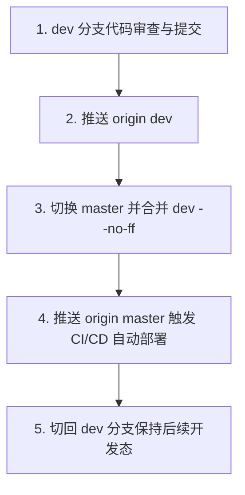

# Agent 工作准则与规范

## Web / Mac 界面同步

- UI 优化默认同时覆盖 Web 和 Mac：配色、品牌标志、排版、组件状态与交互反馈保持一致。
- 修改前检查两端对应组件，适配 Claude / 经典及深浅色；按平台保留必要的原生布局和交互差异。
- 完成时分别验证两端，更新实际使用的前端构建产物和原生测试版本，避免只改一端源码。

## 本地开发服务启动与关闭流程

### 1. Web 与后端本地开发服务（Docker Compose）

- 配置文件：`deploy/docker-compose.dev.yml`、`deploy/nginx.dev.conf`。
- 前端源码（`oci-server/src/main/resources/static/modern-ui/src/*.jsx`）修改后，先编译 `dist/` 产物；`web` 容器已直接挂载静态目录并禁用缓存，无需重打后端镜像：
  ```bash
  npm --prefix oci-server/modern-ui-build run build
  ```
- 启动或更新服务（仅前端静态改动可不加 `--build`；改动后端代码或镜像依赖时加 `--build`）：
  ```bash
  docker compose -f deploy/docker-compose.dev.yml up -d
  # 如需重建后端镜像（镜像直接复制 oci-server/target/oci-pool-release.jar，需先打包）：
  mvn -q -pl oci-server -am package -DskipTests
  docker compose -f deploy/docker-compose.dev.yml up -d --build
  ```
- 验证状态与访问地址：
  - 容器状态：`docker compose -f deploy/docker-compose.dev.yml ps`
  - 后端健康检查：`http://127.0.0.1:19856/actuator/health`
  - Web 预览入口：`http://127.0.0.1:19857/`（默认管理员：`admin` / `Dev@123456`，可通过 `DEV_ADMIN_USERNAME`、`DEV_ADMIN_PASSWORD` 覆盖）
- 关闭并清理容器与网络（保留 `deploy/dev/` 数据卷）：
  ```bash
  docker compose -f deploy/docker-compose.dev.yml down
  ```

### 2. Mac 客户端本地预览（隔离 bundle ID）

- 避免覆盖 `/Applications/OciPool.app` 及正式版偏好，使用 `.build/ui-preview` 副本与独立 `com.nodewebzsz.ocipool.ui-dev`：
  ```bash
  xcodebuild -project oci-pool-mac/OciPool.xcodeproj -scheme OciPool -configuration Debug -derivedDataPath oci-pool-mac/.build/ui-dev CODE_SIGN_ALLOWED=NO build
  ditto oci-pool-mac/.build/ui-dev/Build/Products/Debug/OciPool.app oci-pool-mac/.build/ui-preview/OciPool.app
  /usr/libexec/PlistBuddy -c 'Set :CFBundleIdentifier com.nodewebzsz.ocipool.ui-dev' oci-pool-mac/.build/ui-preview/OciPool.app/Contents/Info.plist
  codesign --force --deep --sign - oci-pool-mac/.build/ui-preview/OciPool.app
  open oci-pool-mac/.build/ui-preview/OciPool.app
  ```
- 如在本地 Mac 预览中连接开发后端，可使用远程模式接入 `http://127.0.0.1:19857`。

## 一、 统一规范的「提交代码」标准 SOP

当用户发出 **“提交代码”** 或类似意图的指令时，**必须默认自动执行以下固化流程，无需用户再次提醒**：



### 详细步骤规范：

1. **第 1 步（本地提交）**：
   - 检查并在 `dev` 分支审查变动；
   - 确保代码格式良好且编译测试通过；
   - 执行 `git add` 并使用规范的 Conventional Commits 完成 `git commit`。
2. **第 2 步（同步 dev 远程）**：
   - 执行 `git push origin dev`，确保开发分支在远程有完整备份。
3. **第 3 步（合并 master）**：
   - 切换到 `master` 分支：`git checkout master && git pull origin master`；
   - 执行合并：`git merge dev --no-ff -m "Merge branch 'dev'"`。
4. **第 4 步（触发线上部署）**：
   - 执行 `git push origin master`；
   - 触发 master 主分支的 GitHub Actions CI/CD 自动化构建发布流程（如 Docker 镜像构建、推送及版本自增）。
5. **第 5 步（切回开发态）**：
   - 切换回 `dev` 分支：`git checkout dev && git merge master`；
   - 同步 `dev` 远端：`git push origin dev`；
   - 保证后续新需求继续在 `dev` 分支上稳健推进。
